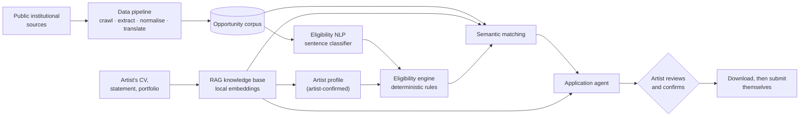

# OpenArt

**Find the open calls you can actually apply to, and get help writing the application.**

OpenArt is a web app for artists. It collects residencies, grants and commissions
from public institutional sources, reads their eligibility rules, and tells each
artist plainly whether they qualify and why. Then it helps them prepare the
application, and the artist reviews every word before anything leaves their hands.

🌐 **Live:** [open-art.lucadev.org](https://open-art.lucadev.org)

---

## The problem

Open calls are scattered across hundreds of institutions, in many languages, and
each one states its eligibility rules in its own dense wording: *"applicants must
be under 35, resident in the region for at least two years, and not enrolled in
full-time education."* Artists spend hours reading calls they were never allowed
to apply to.

OpenArt reads that wording automatically and answers three questions:

1. **What fits my practice?** Semantic search over the corpus, seeded from the artist's own statement.
2. **Can I apply?** A verdict for every call, with each reason quoted from the call's own text.
3. **How do I apply?** A checklist of what to write and what to gather, and an assistant that drafts the texts from the artist's own documents.

## How it works



| Stage | What it does |
|---|---|
| **Data pipeline** | Finds calls on curated public sources, extracts structured fields (deadline, funding, fee, materials, questions…), deduplicates and translates them to English. |
| **Eligibility NLP** *(research core)* | Splits each call's requirements into sentences and tags each one with the requirement types it states: residence, nationality, age, discipline, career stage, education, student status, applicant type, prior funding. |
| **Eligibility engine** | Plain Python rules compare the tagged requirements with the artist's profile and return **Eligible**, **Not eligible** or **Check**, each with the quoted sentence that decided it. |
| **Semantic matching** | Ranks calls by how close they are to the artist's practice, with filters and an explained match score. |
| **RAG knowledge base** | The artist's documents are chunked under their headings and embedded on the server. The profile is pre-filled from the CV by rules, and the artist confirms each value. |
| **Application agent** | Builds a checklist for the call, drafts each written item from the artist's documents, projects and other drafts, and keeps every draft "not reviewed" until the artist confirms it. |

## The research question

> **RQ1: Can NLP automatically identify eligibility requirements in art open calls?**

This is the machine-learning core of the project, and it follows a deliberate,
measured path:

- **Hand-annotated corpus.** About 700 requirement sentences, labelled over several
  rounds with a written taxonomy ([`ANNOTATION_GUIDELINES.md`](ANNOTATION_GUIDELINES.md))
  and a blind inter-annotator review.
- **Baseline first.** TF-IDF + Logistic Regression, then a Linear SVM, then frozen
  sentence embeddings (`bge-base-en-v1.5`) + Logistic Regression. Hyperparameters come
  from `GridSearchCV`, class imbalance is handled with balanced class weights, and the
  models are evaluated with grouped, stratified cross-validation (no call is split
  across train and test) over 10 fold seeds.
- **Multi-label.** One sentence often states several rules ("over 18, fluent in French,
  resident in Senegal"). A one-vs-rest model cut the share of missed requirements from
  49% to 27%.
- **LLM as a yardstick, not a replacement.** A few-shot LLM classifier and an "LLM
  extracts everything" pipeline were both measured against this one. The local model
  comes within a few points of F1. The full pipeline wrongly turned away **0** artists
  on held-out calls, against 14 for the LLM alone.

| Model (11 classes) | Macro-F1 (mean ± std, 10 seeds) |
|---|---|
| TF-IDF + Logistic Regression (baseline) | 0.650 ± 0.016 |
| TF-IDF + Linear SVM | 0.646 ± 0.016 |
| **Embeddings + Logistic Regression (shipped)** | **0.701 ± 0.012** |

The notebooks in [`notebooks/`](notebooks/) reproduce every number, including the
EDA, the single-label and multi-label classifiers, and the learning curves.

## Design principles

- **The final decision is deterministic and auditable.** An LLM never decides
  eligibility. The ML model tags sentences, and plain Python rules decide, so every
  verdict can be traced back to a quoted sentence. When a sentence is ambiguous, the
  answer is *Check*, not a guess.
- **Human in the loop by design.** Values read from a CV are only suggestions until
  the artist saves them. A draft is never final until the artist marks it reviewed.
  The app **never submits an application** or sends a message on anyone's behalf.
- **Private by default.** Embeddings run on the server and the CV is parsed by rules,
  so uploaded documents never go to a third party. The only external calls are the
  drafting assistant's, and the page says exactly what each one sends.
- **Simple, defensible choices.** Frozen embeddings + a linear model instead of
  fine-tuning. One embedding model for classification, matching and RAG.
  Flat files for the corpus and Postgres for app state.

## Tech stack

| Layer | Technology |
|---|---|
| Frontend | Next.js 16 (App Router), React 19, TypeScript, plain CSS Modules |
| API | FastAPI, SQLAlchemy, Alembic, Pydantic, Argon2 password hashing |
| Database | PostgreSQL 17 + **pgvector** (accounts, documents, passages and their embeddings, drafts) |
| ML / NLP | scikit-learn, **fastembed** (ONNX Runtime) with `BAAI/bge-base-en-v1.5`, pandas |
| LLM | OpenAI, used only for offline data extraction and for drafting in the agent |
| Infra | Docker Compose, nginx + HTTPS, pm2, `uv` for reproducible Python environments |

A few details worth mentioning:

- **ONNX instead of PyTorch.** fastembed runs the same model weights as
  `sentence-transformers` and produces the same vectors, at a fraction of the image
  size. One runtime serves the classifier, the search index and the RAG store.
- **Typed end to end.** The frontend's API types are generated from FastAPI's
  OpenAPI schema (`npm run types:api`), so a backend change that breaks the frontend
  fails at compile time.
- **Hardened by default.** Every container port is bound to localhost so only nginx
  is reachable from outside. Session cookies are HTTP-only, state-changing requests
  are origin-checked, uploads are type- and size-limited, and the API container runs
  as an unprivileged user.

## Repository layout

```
open_art/
├── src/                  # the Python core, importable by scripts, notebooks and the API
│   ├── collectors/       #   discovery and structured extraction of calls
│   ├── processing/       #   normalisation: deadlines, places, funding, translation, dedup
│   ├── eligibility/      #   chunking, classifier, value readers, the rule engine
│   ├── matching/         #   embedding index, filters, ranking, match explanations
│   ├── rag/              #   document ingestion, knowledge base, CV-to-profile rules
│   ├── agent/            #   application checklist and drafting
│   └── models/           #   shared data models
├── api/                  # FastAPI app: auth, documents, profile, discover, projects, applications
│   └── migrations/       #   Alembic schema migrations
├── web/                  # Next.js frontend
│   ├── app/              #   routes: auth, onboarding, discover, opportunity, apply, studio
│   ├── components/       #   UI components, one folder each with its CSS Module
│   └── lib/              #   API client and generated types
├── notebooks/            # EDA, annotation, single- and multi-label classifier notebooks
├── scripts/              # pipeline runner, index builders, evaluation scripts
├── dataset/              # the published corpus, annotation labels and classified requirements
├── artifacts/            # trained models, search index, match-score weights
├── examples/             # fictional artist personas and test CVs for evaluation
├── tests/                # pytest suite (pipeline, engine, RAG, API)
├── deploy/               # server configuration
├── Dockerfile
└── docker-compose.yml
```

## Running it

### Visit online

The simplest way: **[open-art.lucadev.org](https://open-art.lucadev.org)**. Sign up,
upload a CV and a statement (or skip that), and explore.

### Run locally

**Requirements:** Docker, Node.js ≥ 20.9, and [`uv`](https://docs.astral.sh/uv/) for the Python tooling.

```bash
# 1. configuration
cp .env.example .env
#    fill in POSTGRES_PASSWORD (openssl rand -hex 32) and OPENAI_API_KEY, and for local use set:
#    COOKIE_SECURE=false
#    ALLOWED_ORIGINS=http://localhost:3040,http://127.0.0.1:3040

# 2. API + database (migrations run automatically on start)
docker compose up --build          # API on 127.0.0.1:8040, Postgres on 127.0.0.1:5434

# 3. frontend, in a second terminal
cd web
npm install
npm run dev                        # http://localhost:3040
```


### Notebooks, tests and tools

```bash
uv sync                                         # install the Python environment (Python 3.13)
                                                # then open notebooks/ in your editor with the .venv kernel
uv run pytest                                   # the test suite
uv run python scripts/search_opportunities.py "sound installations about water" --type Residency
```


*All artist personas and CVs in `examples/` are fictional.*
